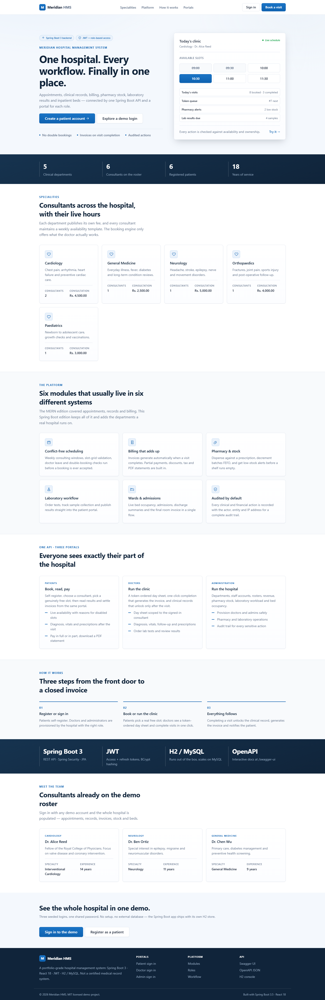
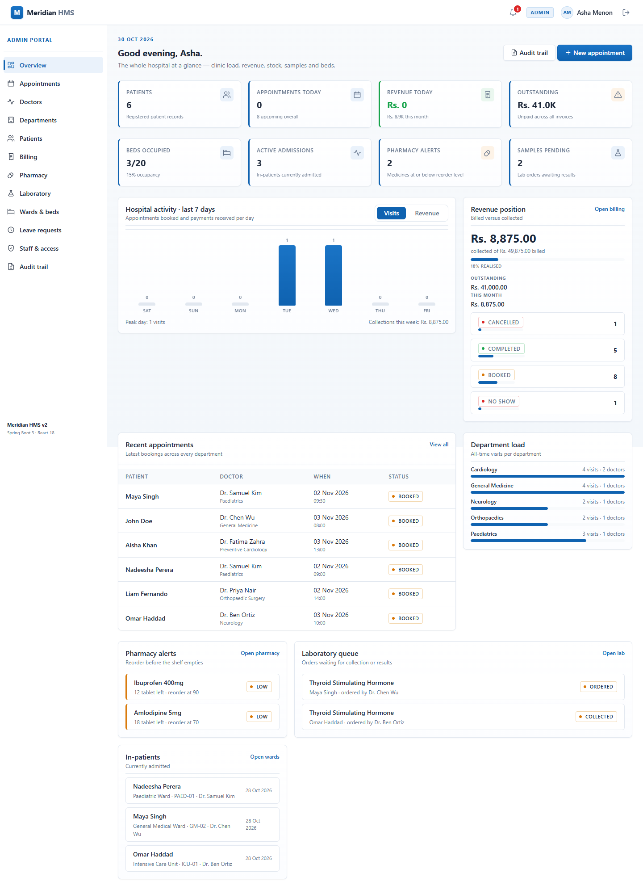
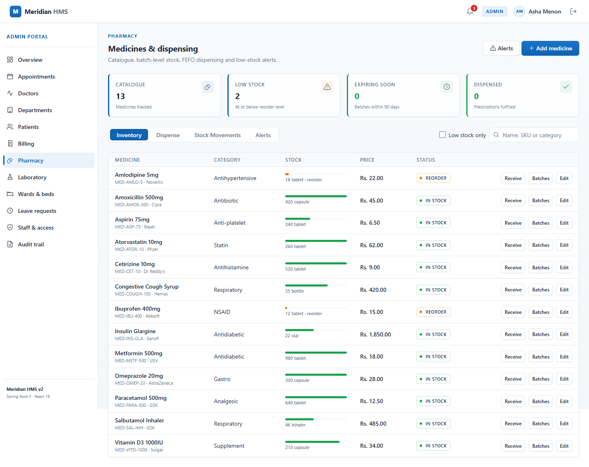
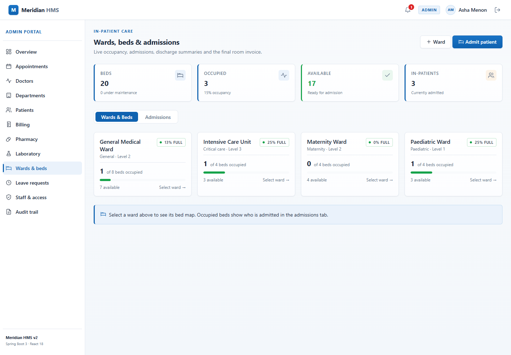
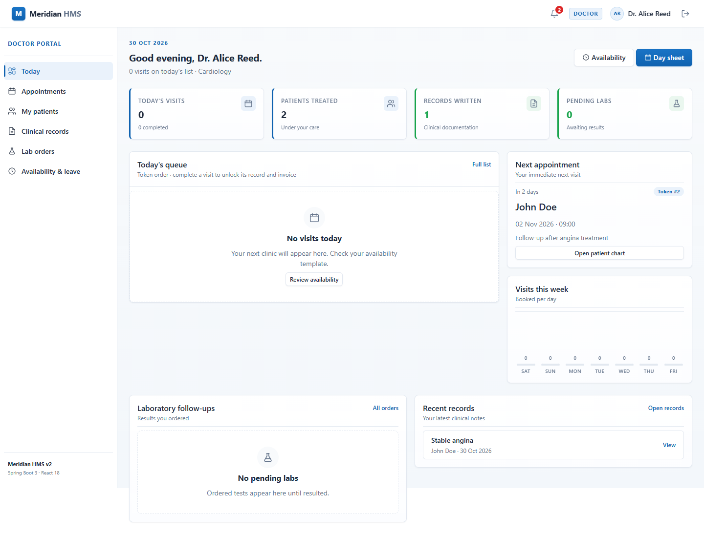
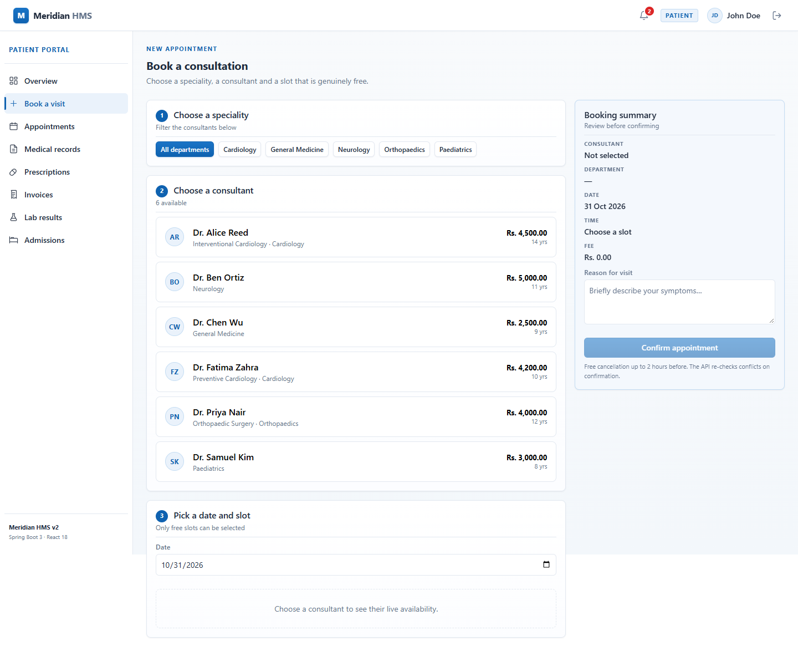
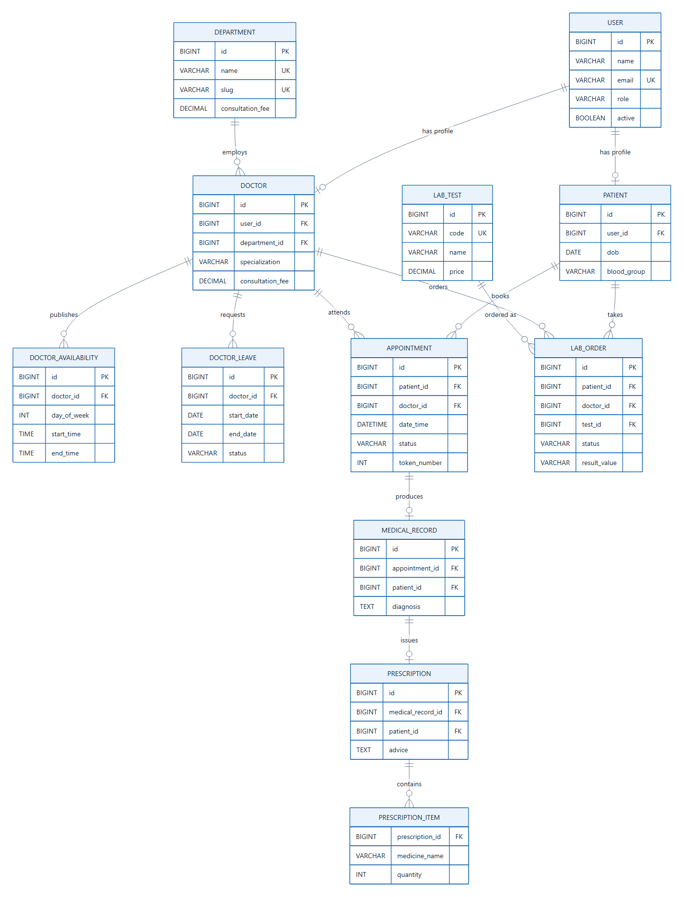

# Meridian HMS — React + Express/Node + Spring Boot Hybrid

> **Current build / pre-commit checks:** Start with [CURRENT_SETUP.md](docs/CURRENT_SETUP.md) and [PRECOMMIT_REVIEW.md](docs/PRECOMMIT_REVIEW.md). There are five roles: Administrator, Doctor, Patient, Receptionist and Pharmacist. Node.js 20+ and Java 21 are required. Local AI uses Ollama; models, databases, backups and JAR binaries are excluded from Git. Older demo/startup notes below are historical.

> **Personal account update:** Follow [ACCOUNT_SETUP.md](ACCOUNT_SETUP.md) for current startup and account instructions. Demo sign-in has been removed and automatic demo seeding is disabled. Register a patient account and then sign in with your own password. Existing database records are preserved. Historical demo instructions below only apply when demo seeding is explicitly enabled.

> **NEW — Option A hybrid gateway:** This package now includes a genuine **Node.js + Express** application in front of the existing **React + Spring Boot** application. Run `START-HYBRID-WINDOWS.bat` or `./START-HYBRID-LINUX-MAC.sh`, then browse **http://localhost:5000**. The Express gateway proxies the existing hospital APIs and adds a persistent, authenticated **Feedback & Support** service at `/support`. See [Hybrid Gateway — run & API guide](docs/HYBRID_GATEWAY.md). This is **not** MongoDB/MERN; the Spring/H2 hospital modules are unchanged. The original standalone Spring Boot runners still work on port **8080**.

A complete hospital management system with three role-specific portals on one API:
**patients** book and pay, **doctors** run their clinics and write records, and
**administrators** run the hospital — staff, departments, billing, pharmacy, laboratory and beds.

This edition takes the original MERN project and **replaces the Node/Express + MongoDB backend with
Spring Boot 3 / Spring Data JPA**, then extends it with six new hospital modules. The React frontend
was rebuilt against the new API and ships inside the same executable jar.

> **Original Java-only mode:** double-click `RUN-WINDOWS.bat` (or `./RUN-LINUX-MAC.sh`).
> The original standalone Java runner starts at **http://localhost:8080**. For the new hybrid version, use the `START-HYBRID` runner and browse **http://localhost:5000**.

---

## Table of contents

- [What's new compared with the MERN edition](#whats-new-compared-with-the-mern-edition)
- [Screenshots](#screenshots)
- [Tech stack](#tech-stack)
- [Quick start](#quick-start)
- [Demo accounts](#demo-accounts)
- [Feature tour](#feature-tour)
- [Architecture](#architecture)
- [Business rules that are actually enforced](#business-rules-that-are-actually-enforced)
- [API overview](#api-overview)
- [Database & profiles](#database--profiles)
- [Testing & verification](#testing--verification)
- [Project structure](#project-structure)
- [Troubleshooting](#troubleshooting)
- [Known limitations](#known-limitations)

---

## What's new compared with the MERN edition

Everything from the original project was ported **and** verified: JWT auth with refresh, role- and
ownership-based access control, conflict-checked appointment booking, clinical records,
prescriptions, auto-invoicing and partial payments.

New in this Spring Boot edition:

| Module | What it does |
|---|---|
| **Pharmacy inventory** | Medicine catalogue, batch-level stock with expiry, FEFO dispensing against prescriptions, stock movements, reorder alerts and near-expiry warnings. |
| **Laboratory** | Test catalogue, doctor-ordered tests, sample collection, result entry with reference ranges, and results published to the patient portal. |
| **Wards, beds & admissions** | Live occupancy map, admissions, discharge summary, automatic bed release and a discharge invoice for room + consultant charges. |
| **Doctor leave** | Doctors request leave; administrators approve or reject it. Approved leave blocks new bookings on those dates. |
| **Notifications** | In-app inbox with unread badge, generated on booking, cancellation, completion, payment, lab result, admission, discharge and low stock. |
| **Audit trail** | A Spring AOP aspect records every sensitive action with actor, role, entity, id and IP address. |
| **Analytics dashboard** | Role-aware KPIs, 7-day activity/revenue chart, department load, bed occupancy, stock and lab queues. |
| **PDF invoices** | Server-rendered A4 invoice with line items, payments and balance (OpenPDF). |
| **OpenAPI docs** | Interactive Swagger UI at `/swagger-ui.html`. |
| **Zero-setup database** | File-backed H2 included; a MySQL profile is provided for production-style runs. |
| **Full appointment CRUD** | Create, list/search/filter/sort, view details, reschedule (conflict-checked) and safe delete of closed appointments. |

The frontend was also rebuilt with dedicated screens for every new module and a responsive
layout, while keeping the original design system and colour language.

---

## Screenshots

| | |
|---|---|
| Public landing page | Admin overview |
|  |  |
| Pharmacy inventory | Wards & beds |
|  |  |
| Doctor day sheet | Patient booking |
|  |  |

More in [`docs/screenshots`](docs/screenshots).

---

## Tech stack

| Layer | Choice |
|---|---|
| Runtimes | **Node.js 20+** (Express gateway) + **Java 21** (hospital backend) |
| Gateway and new service | **Express 4**, Helmet, Express Rate Limit; disk-persisted Feedback & Support |
| Framework | Spring Boot 3.5 (Web, Data JPA, Security, Validation, AOP) |
| Auth | JWT access + refresh tokens (`jjwt`), BCrypt password hashing |
| Database | H2 file database (default) · MySQL 8 via the `mysql` profile |
| API docs | springdoc-openapi (Swagger UI) |
| PDF | OpenPDF 2.x |
| Frontend | React 18, Vite 5, React Router 6, Axios |
| Styling | Hand-written CSS design tokens, no UI framework |
| Build | Maven 3.9 |

---

## Quick start

### Option A — run the prebuilt jar (recommended)

Requirements: **Java 21 or newer** only.

```bash
# Windows
RUN-WINDOWS.bat

# Linux / macOS
chmod +x RUN-LINUX-MAC.sh
./RUN-LINUX-MAC.sh

# or manually, from this folder
java -jar hospital-management-system.jar
```

Open **http://localhost:8080**. The first start creates `./data/meridian.mv.db` and seeds the demo
hospital (users, appointments, records, invoices, stock, lab orders, beds, notifications, audit rows).

### Option B — build from source

Requirements: **JDK 21+**, **Node.js 18+**. Maven is **not** required: the project ships with the
Maven Wrapper (`backend/mvnw.cmd` / `backend/mvnw`), which downloads Maven 3.9.16 on first use.

```bash
# 1. frontend -> backend/src/main/resources/static
cd frontend
npm install
npm run build

# 2. backend jar (wrapper downloads Maven once)
cd ../backend
./mvnw clean package -DskipTests          # Windows: .\mvnw.cmd clean package -DskipTests

# 3. copy the jar to the project root and run it
cp target/hospital-management-system.jar ../hospital-management-system.jar
cd ..
java -jar hospital-management-system.jar
```

Or run in development mode with two processes:

```bash
# terminal 1 — API on :8080
cd backend
./mvnw spring-boot:run                    # Windows: .\mvnw.cmd spring-boot:run

# terminal 2 — Vite dev server on :5173 (proxies /api to :8080)
cd frontend
npm install
npm run dev
```

The `build-from-source.bat` script automates the production build on Windows.

### Option C — run it inside VS Code (A to Z)

**1. Install the tools**

- [VS Code](https://code.visualstudio.com/)
- **JDK 21+** ([Adoptium Temurin](https://adoptium.net/)) — verify with `java -version`
- **Node.js 18+** ([nodejs.org](https://nodejs.org/)) — verify with `node -v` and `npm -v`

**2. Open the project**

`File → Open Folder…` → select the extracted **`Meridian-HMS-SpringBoot`** folder
(the folder that contains `hospital-management-system.jar` and `backend/`).

Open the integrated terminal with **Ctrl + `**.

**3. Install the recommended extensions (one time)**

When VS Code shows "This workspace has extension recommendations", click **Install All**, or install:

- Extension Pack for Java (`vscjava.vscode-java-pack`)
- Spring Boot Extension Pack (`vmware.vscode-spring-boot`)
- Spring Boot Dashboard (`vscjava.vscode-spring-boot-dashboard`)

**4. Run the ready-made application (fastest)**

```powershell
java -jar .\hospital-management-system.jar
```

Wait for `Started HmsApplication` in the terminal, then open **http://localhost:8080**.
Sign in with `admin@hospital.test` / `Password123!`.

> In VS Code you can also press **Ctrl+Shift+B** (default build task) to rebuild, or use
> **Terminal → Run Task… → "1 · Run packaged app"**.

**5. Run the backend in development mode**

```powershell
cd backend
.\mvnw.cmd spring-boot:run
```

The Maven wrapper downloads Maven on first run, resolves Spring Boot dependencies, and starts the API
on **:8080**. The database is created in `backend/data/`.

**6. Run the frontend dev server (second terminal)**

```powershell
cd frontend
npm install        # first time only
npm run dev
```

Open **http://localhost:5173**. Vite proxies `/api` to `http://localhost:8080`, so both servers must
be running. Edits to React files hot-reload instantly.

**7. Debug the backend with F5**

The workspace includes `.vscode/launch.json`. Open `backend/src/main/java/com/meridian/hms/HmsApplication.java`,
set a breakpoint, then press **F5** and choose **"Backend · HmsApplication (Spring Boot)"**.

**8. Build after changing code**

```powershell
# terminal in the project root
cd frontend
npm run build                      # writes into backend/src/main/resources/static
cd ..\backend
.\mvnw.cmd -DskipTests package
copy target\hospital-management-system.jar ..\hospital-management-system.jar
```

Or press **Ctrl+Shift+B** and run the **"Build all (frontend + jar)"** task.

**9. Stop / restart**

- Stop the server with **Ctrl+C** in its terminal.
- Restart with the same command. Data is kept in `data/` (jar) or `backend/data/` (dev run).
- To reset the demo: stop the server, delete the `data` folder, start again.

**10. Useful URLs**

| URL | What |
|---|---|
| http://localhost:8080 | The application |
| http://localhost:8080/swagger-ui.html | Interactive API docs |
| http://localhost:8080/h2-console | Database console (JDBC `jdbc:h2:file:./data/meridian`, user `sa`, empty password) |
| http://localhost:5173 | Frontend dev server (only while `npm run dev` is running) |

### Reset the demo data

Stop the app, delete the `data/` folder, and start again. The seeder only runs against an empty
database, so restarting never duplicates records.

---

## Demo accounts

Every seeded account uses the password **`Password123!`**.

| Role | Email | Name / note |
|---|---|---|
| Admin | `admin@hospital.test` | Asha Menon — full hospital access |
| Admin | `admin.ops@hospital.test` | Ravi Kumar — second administrator |
| Doctor | `doctor@hospital.test` | Dr. Alice Reed — Cardiology, Mon–Fri 09:00–13:00 |
| Doctor | `doctor.neuro@hospital.test` | Dr. Ben Ortiz — Neurology, Tue/Thu/Sat 10:00–14:00 |
| Doctor | `doctor.gp@hospital.test` | Dr. Chen Wu — General Medicine, Mon–Sat 08:00–12:00 |
| Doctor | `doctor.ortho@hospital.test` | Dr. Priya Nair — Orthopaedics, Mon/Wed/Fri 14:00–18:00 |
| Doctor | `doctor.paeds@hospital.test` | Dr. Samuel Kim — Paediatrics, split clinics |
| Doctor | `doctor.cardio2@hospital.test` | Dr. Fatima Zahra — Preventive Cardiology |
| Patient | `patient@hospital.test` | John Doe |
| Patient | `patient.maya@hospital.test` | Maya Singh — currently admitted |
| Patient | `patient.omar@hospital.test` | Omar Haddad — ICU in-patient |
| Patient | `patient.nadeesha@hospital.test` | Nadeesha Perera — paediatric in-patient |
| Patient | `patient.liam@hospital.test` | Liam Fernando — discharged after knee surgery |
| Patient | `patient.aisha@hospital.test` | Aisha Khan |

The login screen has **one-click demo buttons** for the admin, doctor and patient accounts.

---

## Feature tour

### Patient portal

- **Book a consultation** in three steps: speciality → consultant → date and live slot grid.
  Slots already booked, in the past, outside the rota or on approved leave are disabled **and**
  rejected by the API.
- **Overview** with next appointment, token number, outstanding balance, active admission and
  recent results.
- **Appointments** in upcoming / past / cancelled tabs, with free cancellation up to 2 hours before.
- **Medical records** with diagnosis, symptoms, vitals, clinical notes, follow-up date and prescriptions.
- **Prescriptions** with a "dispensed" status pulled from the pharmacy.
- **Invoices**: partial or full payment, PDF download, outstanding balance.
- **Laboratory results** with reference ranges and progress for pending samples.
- **Admissions** with bed, treating consultant, stay length and the discharge invoice.
- **Notifications** inbox with unread count.

### Doctor portal

- **Today**: token-ordered queue, next appointment, weekly activity chart, pending labs and leave.
- **Appointments**: complete a visit (generates the invoice), mark no-show, cancel, or write the record.
- **My patients**: only patients with a treatment relationship (enforced server-side), plus a full chart.
- **Clinical records**: write diagnosis, symptoms, vitals, notes, follow-up, prescription items and lab
  orders in one form.
- **Lab orders**: order tests for treated patients and review published results.
- **Availability & leave**: edit the weekly consulting windows, preview exactly what patients see,
  request leave and track its approval.

### Admin portal

- **Overview**: KPIs, 7-day visit/revenue chart, revenue position, department load, recent bookings,
  stock alerts, lab queue and in-patients.
- **Appointments**: every booking, filters, admin booking with the same conflict detection,
  complete / cancel / no-show.
- **Doctors** and **Departments**: profiles, fees, rota summaries, provisioning and deactivation.
- **Patients**: searchable register with a full chart.
- **Billing**: billed/collected/outstanding, payments, discounts, voiding, PDF invoices.
- **Pharmacy**: inventory with stock bars, receive stock into batches, dispense prescriptions,
  movement ledger, alerts.
- **Laboratory**: order queue, sample collection, result entry, test catalogue.
- **Wards & beds**: occupancy, bed map, admissions, discharge and invoice.
- **Leave requests**: approve or reject doctor leave.
- **Staff & access**: provision doctors/admins, activate/deactivate accounts.
- **Audit trail**: filter by actor, action or entity.

---

## Architecture

```
┌──────────────────────────── React 18 SPA (Vite) ────────────────────────────┐
│ Landing · Login/Register · Admin portal · Doctor portal · Patient portal     │
└───────────────────────────────────┬─────────────────────────────────────────┘
                                    │ JSON over /api (JWT bearer)
┌───────────────────────────────────▼─────────────────────────────────────────┐
│ Spring Boot 3.5                                                              │
│                                                                              │
│  JwtAuthFilter → SecurityFilterChain → @PreAuthorize → Controller            │
│                                             │                                │
│                                             ▼                                │
│  Service layer (all business rules, ownership checks, transactions)          │
│      appointment · billing · record · pharmacy · lab · ward · dashboard      │
│                                             │                                │
│  Spring Data JPA repositories → Hibernate → H2 (file) / MySQL                │
│                                                                              │
│  Cross-cutting: GlobalExceptionHandler · AuditAspect · NotificationService   │
│                 BillingPdfService · DataSeeder · OpenAPI                     │
└──────────────────────────────────────────────────────────────────────────────┘
```

**Two-layer access control**, exactly as in the original design:

1. **Capability** — `@PreAuthorize` on controllers, plus role checks in services
   ("can a doctor write records at all?").
2. **Ownership** — `AccessControl` checks the loaded row ("is *this* record theirs?").
   Patients can only read their own data; doctors only their own patients, records and appointments;
   admins everything.

The frontend mirrors this with `ProtectedRoute` + `RoleRoute`, but the API never relies on the UI.

**Response envelope**

```jsonc
// success
{ "success": true, "data": { }, "meta": { "page": 1, "limit": 50, "total": 42, "totalPages": 1 } }

// failure
{ "success": false, "error": { "message": "…", "code": "DOCTOR_DOUBLE_BOOKED", "details": [] } }
```

**Cross-cutting Spring features used**

- Bean validation on every request record (`@NotBlank`, `@Email`, `@Min`, …).
- `@RestControllerAdvice` normalises validation, JPA, auth and unexpected errors into the envelope.
- `@Transactional` services for appointment/billing/stock/admission consistency.
- Spring AOP `@Audited` annotation writes the audit trail.
- `@ConfigurationProperties`-style `@Value` settings for tax rate, due days, cancellation window, JWT.
- Spring Security stateless chain with custom JSON entry point and access-denied handler.
- springdoc generates OpenAPI from the controllers; Swagger UI is enabled.

---

## Data model & ERD

The relational model has **25 tables**, surrogate `BIGINT` keys, unique natural keys and enforced
foreign keys. Money is `NUMERIC(12,2)`; statuses are stored as readable enum strings.



The full table catalogue (columns, types, PK/FK/unique constraints), cardinalities and design
decisions are in [`docs/ERD.md`](docs/ERD.md). Highlights:

- One-to-one constraints in the database: one medical record and one invoice per appointment.
- `prescription_items`, `invoice_items`, `invoice_payments` and `dispense_items` are ordered
  element collections (3NF, no duplicated header data).
- Batch-level pharmacy stock with FEFO dispensing and a stock-movement ledger.
- Soft delete for users/doctors/patients/medicines; hard delete only for closed appointments with
  no clinical or billing history.
- Indexes on every natural key and foreign-key column used by the API.

---

## Business rules that are actually enforced

### Appointment booking

`AppointmentService.book()` runs, in order:

| # | Check | Error code |
|---|---|---|
| 1 | Slot is in the future | `SLOT_IN_PAST` |
| 2 | Doctor exists and is active | `DOCTOR_UNAVAILABLE` |
| 3 | Doctor is not on approved leave | `DOCTOR_ON_LEAVE` |
| 4 | Doctor publishes hours for that weekday | `OUTSIDE_AVAILABILITY` |
| 5 | Visit fits entirely inside one window | `OUTSIDE_AVAILABILITY` |
| 6 | Start lands on the slot grid | `INVALID_SLOT_BOUNDARY` |
| 7 | No overlapping booked appointment for the doctor | `DOCTOR_DOUBLE_BOOKED` |
| 8 | No overlapping appointment for the patient | `PATIENT_DOUBLE_BOOKED` |

Overlap uses half-open intervals `[start, end)`. A token number is assigned per doctor per day.

### Billing

- Completing a visit **idempotently** generates its invoice from the doctor's consultation fee.
- `subtotal → discount → +5% tax → total`; money is `BigDecimal` with 2-decimal rounding.
- Status is derived from payments: `PENDING → PARTIALLY_PAID → PAID`, with `VOID` terminal.
- Overpayment is rejected; partial payments leave a running balance.
- Cancelling a visit voids an unpaid invoice; paid invoices are never voided.
- Discharge creates a room + consultant invoice for the stay.

### Clinical records

- A record can only be created for a **completed** appointment owned by the calling doctor.
- One record per appointment (unique constraint), and the visit unlocks the form.
- Prescriptions are stored with the record and can be dispensed by the pharmacy.

### Pharmacy

- Stock lives in batches; dispensing consumes the **earliest-expiring batch first** (FEFO).
- Insufficient stock is rejected before any stock moves.
- Every receipt/dispense writes a stock movement; low stock notifies administrators.
- Prescriptions whose medicines are not in the catalogue are reported as warnings, not silent losses.

### Wards

- A bed can have only one active admission.
- Admitting marks the bed occupied; discharging frees it and generates the invoice.
- Occupied beds cannot be moved to maintenance until the patient is discharged.

---

## API overview

Base URL: `/api`. Send `Authorization: Bearer <accessToken>` for everything except `/auth/**` and
`/public/**`. Full interactive docs: **http://localhost:8080/swagger-ui.html**.

| Area | Endpoints |
|---|---|
| Auth | `POST /auth/register`, `/auth/login`, `/auth/refresh`, `/auth/logout` · `GET /auth/me` · `PATCH /auth/profile`, `/auth/password` |
| Public | `GET /public/stats`, `/public/departments`, `/public/doctors`, `/public/doctors/{id}/availability` |
| Users | `GET /users` · `GET /users/{id}` · `POST /users/staff` · `PATCH /users/{id}/status` (admin) |
| Departments | `GET /departments` · `GET /departments/{id}` · `POST` / `PATCH` / `DELETE` (admin) |
| Doctors | `GET /doctors` · `/doctors/me` · `/doctors/{id}` · `/doctors/{id}/availability` · `/doctors/{id}/schedule` · `PATCH /doctors/{id}` · `PATCH /doctors/{id}/availability` · `DELETE /doctors/{id}` · leave endpoints |
| Patients | `GET /patients` · `/patients/me` · `/patients/{id}` · `PATCH /patients/{id}` · `DELETE /patients/{id}` |
| Appointments | `POST /appointments` · `GET /appointments` · `/appointments/me` · `/appointments/{id}` · `PATCH /appointments/{id}/cancel` · `/reschedule` · `/complete` · `/no-show` · `DELETE /appointments/{id}` (admin, closed visits only) |
| Records | `POST /medical-records` · `GET /medical-records` · `/patient/{patientId}` · `/{id}` · `PATCH /{id}` · `POST /prescriptions` · `GET /prescriptions` |
| Billing | `GET /billing` · `/summary` · `/patient/{id}` · `POST /billing/{appointmentId}/generate` · `GET /billing/invoice/{id}` · `/pdf` · `POST /pay` · `PATCH` · `DELETE` |
| Pharmacy | `GET /pharmacy/medicines` · `POST` · `PATCH /{id}` · `POST /{id}/stock` · `GET /{id}/batches` · `GET /movements` · `GET /alerts` · `POST /dispense` · `GET /dispenses` |
| Laboratory | `GET /lab/tests` · `POST` / `PATCH` · `POST /lab/orders` · `GET /lab/orders` · `PATCH /orders/{id}/collect` · `/result` · `/cancel` |
| Wards | `GET /wards` · `POST` / `PATCH` · `GET /wards/{id}/beds` · `POST /beds` · `PATCH /beds/{id}` · `/status` · `GET /beds/available` · admissions · `GET /occupancy` |
| Notifications | `GET /notifications` · `/unread-count` · `PATCH /{id}/read` · `POST /read-all` |
| Audit | `GET /audit?action=&entity=&actor=&limit=` (admin) |
| Dashboard | `GET /dashboard` — role-aware payload |

Detailed request/response notes live in [`docs/API.md`](docs/API.md).

---

## Database & profiles

Default (zero setup):

```
jdbc:h2:file:./data/meridian;AUTO_SERVER=TRUE
H2 console: http://localhost:8080/h2-console
JDBC URL:   jdbc:h2:file:./data/meridian
User:       sa
Password:   (empty)
```

The schema is created/updated by Hibernate (`ddl-auto=update`). H2 keeps data between restarts.

MySQL:

```bash
java -jar hospital-management-system.jar --spring.profiles.active=mysql
# env: MYSQL_HOST, MYSQL_PORT, MYSQL_DB, MYSQL_USER, MYSQL_PASSWORD
```

The MySQL profile is in `backend/src/main/resources/application-mysql.properties`.

---

## Submission package (EC4307)

The rubric evidence is packaged in `docs/`:

| File | Purpose |
|---|---|
| `docs/EC4307_Mini_Project_Report.docx` / `.pdf` | 6-page report: introduction, architecture, ERD, CRUD evidence, validation, testing, UI/UX, conclusion, rubric mapping |
| `docs/ERD.md` | Full database design: 25-table catalogue, relationships, keys, design decisions |
| `docs/DEMO_SCRIPT.md` | One-page run-of-show for the 4 min 30 s demonstration |
| `docs/DEMO_SPEECH.md` | Word-for-word speech, cue card and fallback lines |
| `docs/VIDEO_GUIDE.md` | Recording setup (OBS/Zoom), camera framing, delivery and contingency |
| `docs/SUBMISSION_CHECKLIST.md` | What to submit, GitHub push steps, rubric checklist and pre-demo reset |
| `docs/screenshots/` | Screenshots covering every portal and module, the CRUD flows, validation and mobile layout, plus the ERD |

Rename the report and video with your index number before uploading, as required by the rubric.

---

## Testing & verification

The delivered build was verified end to end against a live instance:

- **Unit tests** (`mvn test`): **7 tests, 0 failures** covering invoice totals/discount caps/status
  derivation and the availability rules (grid boundary, published window, non-working day).
- **API smoke tests** (PowerShell/HTTP): login for all three roles, public stats, dashboard payloads,
  doctor availability generation, successful booking, duplicate-booking rejection (`409`),
  rescheduling, safe deletion of a cancelled appointment, completing a visit → invoice, medical
  record + prescription creation, partial payment, invoice PDF download, pharmacy dispensing with
  stock decrement, lab collect + result, admission + discharge + invoice, notifications and audit
  entries.
- **UI walkthrough** (headless Chrome via Playwright): signed in as admin, doctor and patient and
  visited 18 screens. **0 console errors, 0 page errors, 0 HTTP 5xx responses.**
- **Seed verification**: 14 users, 15 appointments, 5 invoices, 13 medicines, 20 beds, 3 active
  admissions, 6 lab orders, notifications and audit entries on a fresh database.

Reproduce the checks with:

```bash
cd backend
./mvnw test                                # Windows: .\mvnw.cmd test

curl -s http://localhost:8080/api/public/stats
curl -s -X POST http://localhost:8080/api/auth/login \
  -H "Content-Type: application/json" \
  -d '{"email":"admin@hospital.test","password":"Password123!"}'
```

---

## Project structure

```
meridian-hms/
├── hospital-management-system.jar     # executable Spring Boot jar (UI included)
├── RUN-WINDOWS.bat / RUN-LINUX-MAC.sh
├── build-from-source.bat
├── docs/
│   ├── API.md
│   └── screenshots/
├── backend/
│   ├── pom.xml
│   └── src/main/
│       ├── java/com/meridian/hms/
│       │   ├── audit/          # @Audited + AOP aspect
│       │   ├── common/         # envelope, errors, paging
│       │   ├── config/         # security, SPA routing, OpenAPI, seeder
│       │   ├── controller/     # 14 REST controllers
│       │   ├── domain/         # 21 JPA entities + enums
│       │   ├── dto/            # request records + response DTOs
│       │   ├── repository/     # 20 Spring Data repositories
│       │   ├── security/       # JWT filter/service, AuthUser, ownership checks
│       │   └── service/        # business logic (12 services)
│       └── resources/
│           ├── application.properties
│           ├── application-mysql.properties
│           └── static/         # built React app (generated by `npm run build`)
└── frontend/
    ├── package.json / vite.config.js
    └── src/
        ├── api/                # axios client + typed endpoint modules
        ├── components/         # layout, UI kit, record form, notification bell
        ├── context/            # auth + toasts
        ├── hooks/              # useApi / useAction
        ├── pages/              # admin, doctor, patient, public
        └── styles.css, app.css
```

---

## Troubleshooting

| Symptom | Fix |
|---|---|
| `java: command not found` / old Java | Install JDK 21+ and run `java -version`. The jar targets Java 21 bytecode. |
| Port 8080 already in use | `java -jar hospital-management-system.jar --server.port=8081` |
| Demo logins fail | Make sure the app seeded: check the log for `Seed complete`. Delete `data/` and restart to reseed. |
| `Table not found` / schema confusion | Stop the app, delete `data/`, restart. |
| Want a clean demo | Stop the app, delete `data/`, start again. |
| Blank page after a rebuild | Rebuild the frontend (`npm run build`) before `mvn package`; the SPA is served from the jar. |
| Invoice PDF won't download | PDFs require the backend; open the app through `http://localhost:8080`, not the Vite dev server without the proxy. |

---

## Known limitations

This is a portfolio/demo system, not a certified medical record product.

- Single-node deployment: no clustering, no external object storage.
- H2 is ideal for the demo; use MySQL for anything long-lived.
- Notifications are in-app only (no email/SMS provider wired in).
- Payments are recorded, not processed by a gateway.
- No file uploads (scans, attachments) yet.
- Times are stored as server-local `LocalDateTime`; a multi-time-zone deployment would need a zone
  per clinic and UTC storage.
- Stateless JWT logout disposes tokens client-side; there is no server-side denylist.

---

**License:** MIT — demo/portfolio project. Do not use with real patient data.
