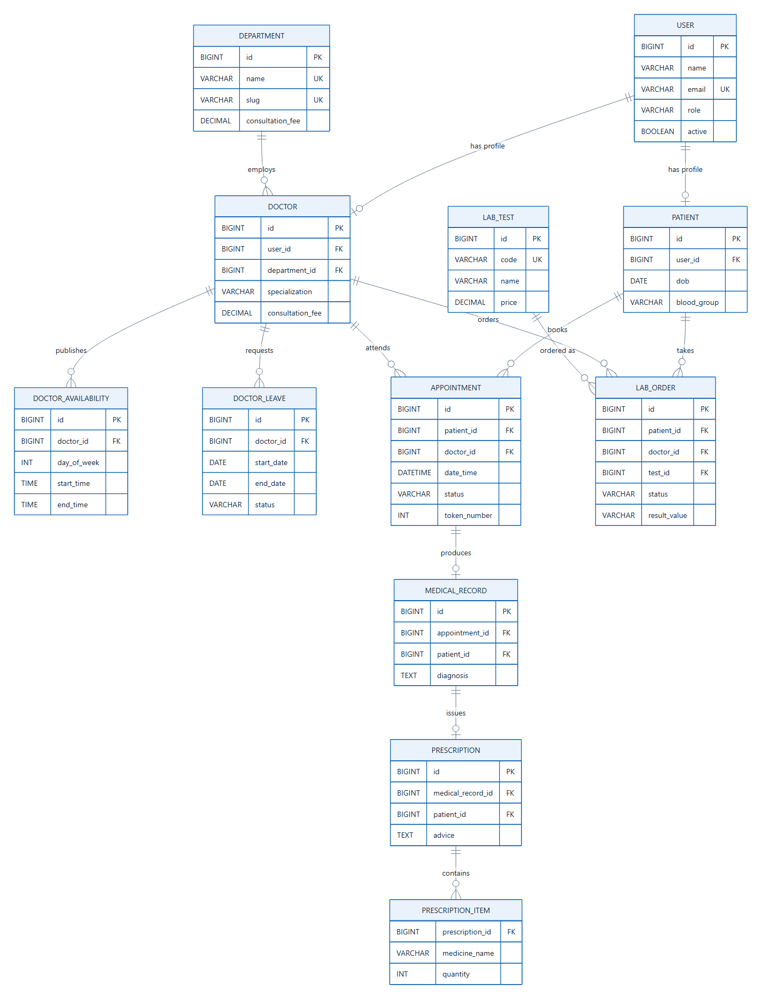

# Database Design & ERD

Meridian HMS uses **25 relational tables** with surrogate `BIGINT` primary keys, enforced foreign
keys, unique constraints on natural keys and `NUMERIC(12,2)` for money. The schema is created by
Hibernate from the JPA entities (`ddl-auto=update`) and runs unchanged on **H2** and **MySQL 8**.

*Figure 1 — Clinical core. A user has either a patient or a doctor profile; doctors publish
availability and leave; patients book appointments; completed appointments produce one medical
record, which can issue one prescription with many items and many lab orders. The billing and
operations half is shown in Figure 2 of the report and catalogued below.*

---

## 1. Table catalogue

| # | Table | Purpose | PK | Foreign keys / unique constraints | Key columns |
|---|---|---|---|---|---|
| 1 | `app_users` | Login identity for all roles | `id` | `email` UNIQUE | `name` VARCHAR, `password_hash` VARCHAR (BCrypt), `role` ENUM(ADMIN, DOCTOR, PATIENT), `phone`, `active` BOOLEAN |
| 2 | `patients` | Patient profile | `id` | `user_id` UNIQUE → `app_users` | `dob` DATE, `gender` ENUM, `blood_group`, `address`, `allergies` TEXT, `insurance_provider` |
| 3 | `departments` | Clinical specialities | `id` | `name` UNIQUE, `slug` UNIQUE | `description` TEXT, `consultation_fee` NUMERIC(12,2), `active` |
| 4 | `doctors` | Consultant profile | `id` | `user_id` UNIQUE → `app_users`; `department_id` → `departments` | `specialization`, `consultation_fee` NUMERIC(12,2), `license_no`, `experience_years` |
| 5 | `doctor_availability` | Weekly consulting windows | `id` | `doctor_id` → `doctors` | `day_of_week` INT (1–7), `start_time` TIME, `end_time` TIME, `slot_minutes` INT |
| 6 | `doctor_leaves` | Leave requests | `id` | `doctor_id` → `doctors` | `start_date`, `end_date` DATE, `reason` TEXT, `status` ENUM(PENDING, APPROVED, REJECTED) |
| 7 | `appointments` | Bookings / visits | `id` | `patient_id` → `patients`; `doctor_id` → `doctors` | `date_time` TIMESTAMP, `duration_minutes` INT, `status` ENUM(BOOKED, COMPLETED, CANCELLED, NO_SHOW), `token_number` INT, `fee` NUMERIC |
| 8 | `medical_records` | Clinical note per visit | `id` | `appointment_id` UNIQUE → `appointments`; `patient_id`, `doctor_id` | `diagnosis` TEXT, `symptoms` TEXT, `blood_pressure`, `pulse`, `temperature`, `weight`, `height`, `spo2`, `follow_up_date` DATE |
| 9 | `prescriptions` | Prescription header | `id` | `medical_record_id` UNIQUE → `medical_records`; `patient_id`, `doctor_id` | `advice` TEXT |
| 10 | `prescription_items` | Prescribed lines (element collection) | — | `prescription_id` → `prescriptions` | `medicine_name`, `dosage`, `frequency`, `duration_days`, `quantity`, `instructions` |
| 11 | `lab_tests` | Test catalogue | `id` | `code` UNIQUE | `name`, `category`, `price` NUMERIC, `sample_type`, `reference_range`, `turnaround_hours` |
| 12 | `lab_orders` | Ordered tests | `id` | `patient_id`, `doctor_id`, `test_id`, `appointment_id` (nullable) | `status` ENUM(ORDERED, COLLECTED, COMPLETED, CANCELLED), `priority` ENUM, `result_value`, `collected_at`, `completed_at` |
| 13 | `invoices` | Consultation / admission invoice | `id` | `invoice_number` UNIQUE; `patient_id`; `appointment_id` UNIQUE (nullable); `admission_id` UNIQUE (nullable) | `sub_total`, `discount`, `tax_amount`, `total_amount`, `amount_paid` NUMERIC(12,2), `status` ENUM, `due_date` |
| 14 | `invoice_items` | Invoice lines | — | `invoice_id` → `invoices` | `description`, `quantity`, `unit_price`, `amount` |
| 15 | `invoice_payments` | Payments received | — | `invoice_id` → `invoices` | `amount` NUMERIC, `method` ENUM, `reference`, `paid_at`, `received_by` |
| 16 | `medicines` | Pharmacy catalogue | `id` | `sku` UNIQUE | `name`, `category`, `unit`, `price` NUMERIC, `reorder_level` INT, `stock_quantity` INT |
| 17 | `stock_batches` | Batch-level stock | `id` | `medicine_id` → `medicines` | `batch_no`, `expiry_date` DATE, `quantity` INT |
| 18 | `stock_movements` | Stock ledger | `id` | `medicine_id` → `medicines` | `type` ENUM(IN, OUT, ADJUSTMENT), `quantity`, `reason`, `reference`, `created_by` |
| 19 | `dispenses` | Dispensing header | `id` | `prescription_id`; `patient_id` | `dispensed_by`, `total_amount`, `notes` |
| 20 | `dispense_items` | Dispensed lines | — | `dispense_id` → `dispenses` | `medicine_name`, `quantity`, `unit_price`, `amount` |
| 21 | `wards` | Wards | `id` | `name` UNIQUE | `type`, `floor`, `active` |
| 22 | `beds` | Beds | `id` | `ward_id` → `wards` | `code`, `daily_charge` NUMERIC, `status` ENUM(AVAILABLE, OCCUPIED, MAINTENANCE) |
| 23 | `admissions` | In-patient stays | `id` | `patient_id`, `doctor_id`, `bed_id` | `admitted_at`, `discharged_at`, `diagnosis` TEXT, `status` ENUM(ADMITTED, DISCHARGED), `daily_charge` |
| 24 | `notifications` | In-app inbox | `id` | `user_id` → `app_users` | `title`, `message` TEXT, `type` ENUM, `link`, `is_read` BOOLEAN |
| 25 | `audit_logs` | Audit trail | `id` | — (append-only) | `actor_name`, `actor_role`, `action`, `entity_type`, `entity_id`, `details` TEXT, `ip_address` |

---

## 2. Relationships and cardinality

| Relationship | Cardinality | Enforced by |
|---|---|---|
| User → Patient | 1 : 0..1 | `patients.user_id` UNIQUE FK |
| User → Doctor | 1 : 0..1 | `doctors.user_id` UNIQUE FK |
| Department → Doctor | 1 : N | `doctors.department_id` FK |
| Doctor → Availability window | 1 : N | `doctor_availability.doctor_id` FK, cascade delete |
| Doctor → Leave | 1 : N | `doctor_leaves.doctor_id` FK |
| Patient → Appointment | 1 : N | `appointments.patient_id` FK |
| Doctor → Appointment | 1 : N | `appointments.doctor_id` FK |
| Appointment → Medical record | 1 : 0..1 | `medical_records.appointment_id` UNIQUE FK |
| Medical record → Prescription | 1 : 0..1 | `prescriptions.medical_record_id` UNIQUE FK |
| Prescription → Prescription item | 1 : N | `prescription_items.prescription_id` FK, ordered collection |
| Patient / Doctor / Test → Lab order | 1 : N | `lab_orders.*` FKs |
| Patient → Invoice | 1 : N | `invoices.patient_id` FK |
| Appointment → Invoice | 1 : 0..1 | `invoices.appointment_id` UNIQUE FK |
| Admission → Invoice | 1 : 0..1 | `invoices.admission_id` UNIQUE FK |
| Invoice → Item / Payment | 1 : N | `invoice_items.invoice_id`, `invoice_payments.invoice_id` |
| Medicine → Batch / Movement | 1 : N | `stock_batches.medicine_id`, `stock_movements.medicine_id` |
| Prescription → Dispense | 1 : N | `dispenses.prescription_id` FK |
| Ward → Bed | 1 : N | `beds.ward_id` FK, cascade delete |
| Patient / Doctor / Bed → Admission | 1 : N / 1 : 0..1 | `admissions.*` FKs |
| User → Notification | 1 : N | `notifications.user_id` FK |
| User → Audit log | 1 : N | `audit_logs.actor_name` (denormalised; logs survive user deletion) |

---

## 3. Design decisions

1. **Surrogate keys everywhere.** Every table has a `BIGINT` identity primary key, so natural keys
   (email, invoice number, SKU, test code) can change without breaking references. Natural keys are
   protected by `UNIQUE` constraints instead.
2. **One-to-one where the domain says one.** A visit produces at most one medical record and at most
   one invoice; the database enforces this with unique foreign keys, not just application checks.
3. **Money is `NUMERIC(12,2)`.** Never floating point. Calculations are rounded `HALF_UP` in the
   service layer and re-derived server-side — the client never sets a total.
4. **Enums are stored as strings.** `@Enumerated(EnumType.STRING)` keeps rows readable and survives
   enum reordering. Invalid values are rejected during JSON binding.
5. **Line items are element collections.** `prescription_items`, `invoice_items`,
   `invoice_payments` and `dispense_items` are owned by their header with ordered columns
   (`line_no`), giving 3NF storage without unnecessary entity classes.
6. **Soft delete where history matters.** Users, doctors, patients and medicines are deactivated
   (`active=false`); appointments are cancelled and invoices voided. Hard delete is limited to
   closed appointments with no clinical or billing history, and to empty departments.
7. **Stock is batch-aware.** `stock_batches` records expiry per batch; dispensing consumes the
   earliest-expiring batch first (FEFO) and writes a `stock_movements` row for every change, giving
   a complete stock ledger.
8. **Audit is append-only and denormalised.** `audit_logs` stores the actor's name and role so the
   trail remains readable even if the account is later deactivated.
9. **Indexes.** Unique indexes exist for `app_users.email`, `departments.name/slug`, `doctors.user_id`,
   `patients.user_id`, `invoices.invoice_number`, `invoices.appointment_id`, `invoices.admission_id`,
   `medical_records.appointment_id`, `prescriptions.medical_record_id`, `lab_tests.code`,
   `medicines.sku`, `wards.name`. Lookup paths are covered by the foreign-key columns.
10. **Portable DDL.** No H2-specific syntax is used in the entities; the same mappings run on MySQL
    with the `mysql` Spring profile.

---

## 4. Notes on referential integrity

- Deleting a doctor is a **deactivation**, so historic appointments and invoices keep valid FKs.
- Departments with doctors are deactivated instead of deleted (the service checks the count first).
- Appointment deletion is blocked when a medical record or invoice references it; those rows are
  financial/clinical history.
- Discharging an admission frees the bed, keeps the admission row and creates the invoice, so the
  stay remains auditable.
